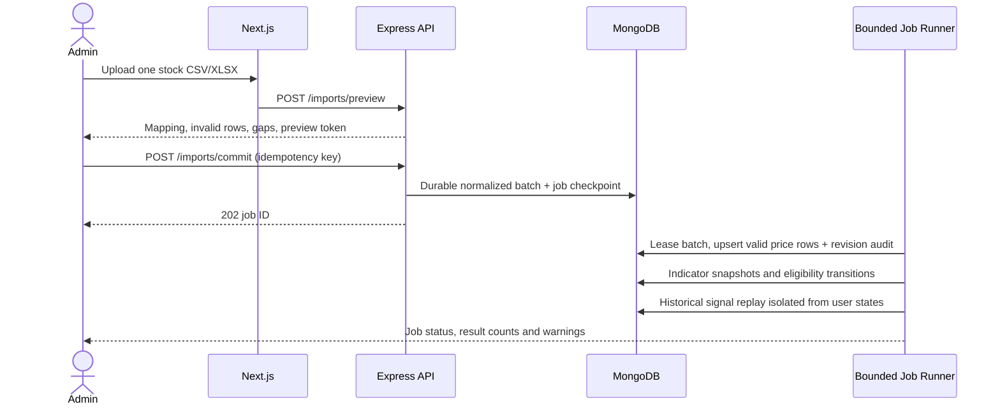
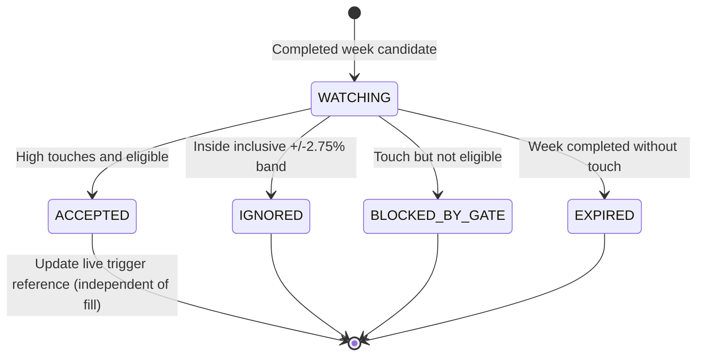
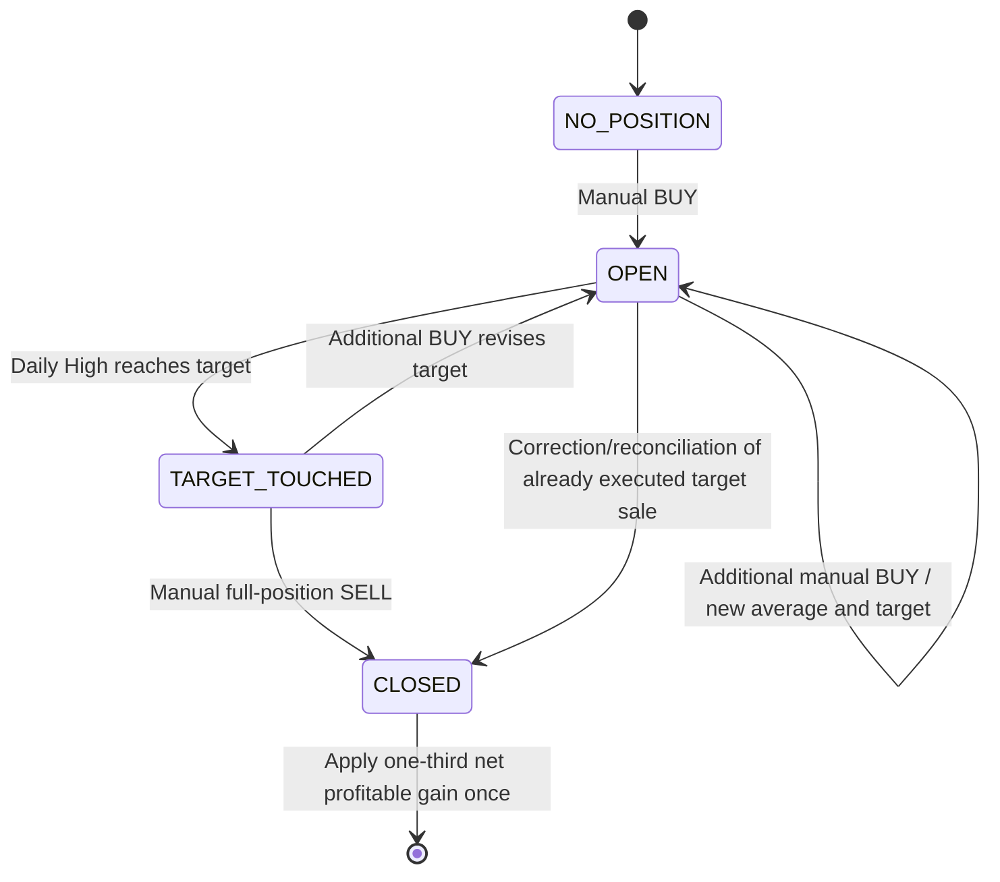

# Advanced Darvas Box — API Design Document (ADD)

**Version:** 1.0  
**Status:** Proposed engineering contract — ready for implementation review  
**Date:** 22 November 2026  
**Baseline:** PRD v1.2; System Design v1.1; LLD v1.0; Database Design v1.0; Nifty 100 GTT screening amendment

## 1. Purpose and scope

This document defines the external browser API, internal scheduler endpoint, domain event contracts, data types, security, idempotency, validation, and verification plan for the Advanced Darvas Box application. It is an implementation specification, **not** an indication that the API has been deployed. The selected architecture is Next.js (Vercel) → same-origin browser proxy → Express/TypeScript (Render) → MongoDB Atlas. Historical price data is uploaded manually **one stock at a time** by an administrator; no live quote ingestion or broker order placement is in scope.

This document refines the route inventories in the approved designs: **`/api/v1` is the canonical public prefix**. Earlier generic `/api/*` references are conceptual. All monetary fields are decimal strings and all session dates are `YYYY-MM-DD` in the NSE exchange calendar (`Asia/Kolkata`).

## 2. Core domain invariants enforced by APIs

1. **New-stock entry gate:** current valid, fresh daily data AND DMA trend `BULL` AND CAR `BUY_AVERAGE_OUT`. The optional 52-week high-before-low suitability rule must not silently veto eligible stocks. It is an independent filter.
2. **DMA:** closing price above 50/100/200 session SMAs and `0.01% ≤ distanceAbove200 ≤ 10%`; bear uses the symmetric negative band. CMA ordering is not a requirement. The latest complete session close is the weekend CMP.
3. **CAR:** anchored at the 52-week highest *high* date; daily closing prices from that anchor; expanding cumulative average; latest 10 ascending in chronological order (nine strictly increasing comparisons). `SHORT_HISTORY` and bad/missing data never qualify.
4. **Weekly candidate:** maximum high of the previous **completed NSE calendar week**. Ignore candidate if within **inclusive** ±2.75% of portfolio-stock's last accepted trigger.
5. **Trigger acceptance:** when that week's daily **high touches or exceeds candidate** and the eligible-screening gate was satisfied as-of the touch. Accept the weekly candidate price (not the actual fill); advance accepted reference even if the user does not trade. One candidate per trading week.
6. **Executed trades are manual.** A touched buy trigger or profit target is not a broker execution. Existing open positions are not automatically sold because they become Bear Run or fail CAR.
7. **Position:** additional buys allowed, average executed share price recalculated, target = 1.06 × weighted average executed price; user manually confirms a full-position sell. There is no stop-loss in the approved strategy.
8. **Capital:** per-stock, per-portfolio investment target; quantity is suggested and overrideable; no shared-cash solvency checks. On completed successful position sequence, add one-third of **net realized capital gain after actual recorded charges**, exactly once. No reinvestment on net loss or zero.
9. **Historical replay is isolated** from live portfolio trigger reference and transactions. Revisions require explicit reconciliation, never silent rewriting of manually confirmed trades.

## 3. Network, authentication, tenancy and security

- Production browser calls a **same-origin Next.js proxy** at `/api/v1/*`; proxy forwards to Express API. Express is the source of authorization truth. Cookies: `HttpOnly`, `Secure`, explicit `SameSite` and path; enforce CSRF defense for mutating cookie-authenticated requests (Origin checks plus anti-CSRF token or equivalent), rate limiting and response redaction.
- Invite-only email/password. `ADMIN` can invite users and upload shared market data; `MEMBER` can manage own portfolios. Only a watchlist with `visibility=FAMILY` is readable by family members; only its owner can edit it (the admin role does not grant access to private portfolios).
- `ownerId` is derived **from the authenticated session**, never trusted from client bodies. Verify ownership of portfolio, position, trade, allocation, alert and trigger before returning data or changing state; non-owned resources return 404 to limit enumeration.
- Email provider credentials, MongoDB URI and job HMAC secret stay server-side. Secrets never enter Next.js public environment variables. Internal scheduler route is not accessible using user cookies alone.
- Request content types: `application/json` except multipart import preview; JSON responses use UTC `createdAt`/`updatedAt` timestamps plus separate NSE session-date fields. Use `Cache-Control: no-store` for private responses.
- Shared stock/indicator endpoints require authenticated membership. Limit upload size, row count, parsed cells, MIME type, extension, CSV formula injection on exports, and XLSX decompression size.

## 4. Standard API conventions

**Base URL:** `/api/v1`  
**Auth:** secure session cookie; CSRF protection on mutation  
**Pagination:** `limit` default 25, max 100, opaque `cursor`, stable sort including `_id`  
**Query dates:** `YYYY-MM-DD` exchange-session dates; server validates valid calendar  
**Decimal:** JSON string, e.g. `"3338.00"`; no JS float for money in persistence  
**Result:** `data`, optional `meta`; errors use the common error envelope  
**Concurrency:** `If-Match: "<integer-version>"` on editing trades, position-sensitive updates and allocation changes  
**Idempotency:** `Idempotency-Key` (UUID) on commits, buys, sells, retries, replays and scheduled digest. Repeating a key with a different payload returns 409.

Success example:

```json
{"data":{"symbol":"ADANIENT","trend":"BULL"},"meta":{"asOfSession":"2026-11-20","ruleVersion":"eligibility-v1.1"}}
```

Error example:

```json
{"error":{"code":"INSUFFICIENT_DATA","message":"200 complete trading sessions are required","details":{"required":200,"available":192},"requestId":"req_abc"}}
```

Main status codes: 200 read/update, 201 created, 202 accepted async work, 204 deletion, 400 malformed, 401 session missing, 403 privilege denied, 404 inaccessible/missing, 409 duplicate/concurrency or rule conflict, 413 too large, 415 unsupported format, 422 domain validation, 429 throttled, 500 unexpected and 503 dependency unavailable. `409 VERSION_CONFLICT` returns latest version; stale-data informational responses are not automatically 500 errors.

## 5. Endpoint catalog

### 5.1 Authentication and family invites

| Method | Endpoint | Access | Purpose |
|---|---|---|---|
| POST | `/auth/login` | Public/rate limited | Credentials login; set session cookie |
| POST | `/auth/logout` | Authenticated | Revoke session and clear cookie |
| GET | `/auth/me` | Authenticated | Session profile, role, family |
| POST | `/invitations` | Admin | Create email invitation via Resend |
| GET | `/invitations` | Admin | List pending, expired, used invitations |
| POST | `/invitations/accept` | Invitee with token | Set password and create account |

**POST `/auth/login`** request `{ "email":"person@example.com", "password":"..." }`. Returns 200 `{data:{user:{id,email,role,familyId}}}` and `Set-Cookie`; generic 401 for invalid credentials, no account enumeration. **POST `/invitations`** `{email,expiresInHours:72}` → 201 `{data:{invitationId,status:"PENDING",expiresAt}}`; no raw invite token in API response. **POST `/invitations/accept`** `{token,password}` → 201 user ID; used/expired token → 422 `INVITATION_INVALID`.

### 5.2 Stocks, screening, price history

| Method | Endpoint | Access | Purpose |
|---|---|---|---|
| GET | `/stocks` | Member | Nifty 100 master list, filters, latest snapshot |
| GET | `/stocks/:symbol/prices` | Member | Adjusted daily OHLCV and data basis |
| GET | `/stocks/:symbol/analysis` | Member | DMA, CAR, 52-week option, eligibility and reasons |
| GET | `/stocks/:symbol/eligibility-history` | Member | Historical eligibility changes, as-of versions |
| GET | `/screener/eligible` | Member | Final List: Bull AND CAR AND fresh/valid |

`GET /stocks?query=TCS&limit=25&cursor=...&trend=BULL` returns paginated stock summaries. `GET /screener/eligible?asOf=2026-11-20&limit=25&sort=distance200Asc` returns only eligible, complete, fresh as-of records; `asOf` is a historical lookup, **not** a live alert. Missing stored snapshot should return 422 `SNAPSHOT_NOT_AVAILABLE` rather than guessing. Indicators include full reason codes and freshness.

Representative `GET /stocks/:symbol/analysis?asOf=2026-11-20`:

```json
{
 "data": {
  "symbol":"TCS", "exchange":"NSE", "asOfSession":"2026-11-20",
  "priceBasis":"ADJUSTED_CLOSE_EOD", "cmp":"3050.00",
  "dma":{"sma50":"3010.00","sma100":"2990.00","sma200":"3000.00","distance200Pct":"1.6667","trend":"BULL"},
  "car":{"rating":"BUY_AVERAGE_OUT","anchorSession":"2026-04-10","validCount":150,"recentCumulativeAverages":["2970.00","2972.00","2973.00","2975.00","2977.00","2978.00","2980.00","2982.00","2985.00","2987.00"]},
  "suitability":{"status":"AVOID","mandatory":false},
  "eligibility":{"eligible":true,"status":"ELIGIBLE","reasons":[],"ruleVersion":"eligibility-v1.1"},
  "dataQuality":{"valid":true,"fresh":true,"latestUploadedSession":"2026-11-20","missingSessions":[]},
  "sourceRevisionKey":"rev_42", "computedAt":"2026-11-21T09:00:00Z"
 }
}
```

The numbers above are **illustrative API fixtures**, not real TCS quotes. `GET /stocks/:symbol/prices?from=&to=&adjustment=adjusted` returns ordered records with prices as decimal strings, adjustmentVersion and source metadata.

### 5.3 Admin imports and asynchronous processing

| Method | Endpoint | Access | Purpose |
|---|---|---|---|
| POST | `/imports/preview` | Admin | Multipart single-stock CSV/XLSX, parse/validate without price writes |
| POST | `/imports/commit` | Admin | Confirm preview and queue durable import job |
| GET | `/imports/jobs/:jobId` | Admin | Progress, validation results and affected date range |
| POST | `/imports/jobs/:jobId/retry` | Admin | Resume failed job idempotently |
| GET | `/imports/batches` | Admin | Audit list of import batches |

**POST `/imports/preview`** multipart fields `file`, `stockSymbol`, optional `mapping` JSON and `adjustmentBasis`. **200** response:

```json
{"data":{"previewToken":"opaque_short_lived_token","symbol":"ADANIENT","fileFormat":"CSV","dateRange":{"from":"2021-11-01","to":"2026-11-20"},"rows":{"read":1250,"valid":1249,"new":1200,"changed":49,"unchanged":0,"rejected":1},"missingSessions":["2024-06-03"],"blockingErrors":[{"row":18,"code":"INVALID_OHLC"}],"warnings":[],"expiresAt":"2026-11-22T12:00:00Z"}}
```

Preview is **not committable** if unresolved blocking errors remain. Missing NSE sessions in the requested indicator interval can block dependent calculations. **POST `/imports/commit`** request `{previewToken}` with `Idempotency-Key` header → **202** `{data:{batchId,jobId,status:"QUEUED"}}`. No on-disk staging dependency: normalize data into durable bounded batches before returning 202, or keep the request synchronous until safely staged. Because Render free workers may sleep, progress must not depend on an always-on process: processing starts after commit and can be resumed by Admin or authenticated scheduler. Job lifecycle: `QUEUED → VALIDATING → UPSERTING → RECALCULATING → REPLAYING → COMPLETED`; failures `FAILED_RETRYABLE`/`FAILED_FINAL`; lease and checkpoint persisted. Corrections create `priceRevisions`, update snapshots and mark affected live-signal events for review; never mutate real trades automatically.

`GET /imports/jobs/:jobId` returns `{data:{jobId,batchId,status,phase,processed,total,inserted,updated,unchanged,failed,errors,startedAt,finishedAt}}`.

### 5.4 Portfolios and per-stock allocations

| Method | Endpoint | Access | Purpose |
|---|---|---|---|
| GET | `/portfolios` | Owner | List own portfolios |
| POST | `/portfolios` | Member | Create named portfolio |
| PATCH | `/portfolios/:portfolioId` | Owner | Rename/modify allowed metadata |
| GET | `/portfolios/:portfolioId/summary` | Owner | Holdings, P&L, invested totals |
| GET | `/portfolios/:portfolioId/positions` | Owner | Open/closed positions |
| GET | `/portfolios/:portfolioId/allocations` | Owner | Per-stock targets |
| PUT | `/portfolios/:portfolioId/allocations/:stockId` | Owner | Initialize or revise planning target |
| GET | `/portfolios/:portfolioId/allocations/:stockId/quantity-suggestion` | Owner | Cost-aware quantity estimate |

**POST `/portfolios`** `{name:"Swing Trading",type:"SWING"}` → 201 `{data:{id,ownerId,name,type,version:1}}`; `ownerId` is server derived. **PUT allocation** `{initialTarget:"50000.00",reason:"Initial allocation"}` with `If-Match` when editing → 200 target version. Quantity suggestion `?price=2400.00&estimatedCharges=25.00` computes maximum whole shares under the current per-stock target and estimated order costs, returns `{quantity:20,estimatedTotalCost:"48025.00",target:"50000.00",canOverride:true}` (illustrative). The estimate is **not** actual available brokerage cash.

### 5.5 Darvas candidates, live trigger reference, historical replay

| Method | Endpoint | Access | Purpose |
|---|---|---|---|
| GET | `/portfolios/:portfolioId/triggers?symbol=` | Owner | Candidate/ignored/accepted event history and latest reference |
| POST | `/portfolios/:portfolioId/triggers/seed` | Owner | Explicitly adopt an inspected historical accepted reference |
| GET | `/stocks/:symbol/replays` | Member | List historical-only replay runs |
| POST | `/stocks/:symbol/replays` | Admin | Request deterministic historical replay |
| GET | `/stocks/:symbol/replays/:runId` | Member | Historical candidate/touch results; no live writes |

**GET triggers** includes `lastAcceptedTrigger`, `lowerIgnorableLimit`, `upperIgnorableLimit`, `currentCandidate`, `candidateStatus`, `touchSession`, `ruleVersion`, `sourceRevisionKey`. **Seed** request `{asOfSession:"2026-11-20",replayRunId:"...",acceptedEventId:"...",reason:"Adopt after review"}` with idempotency header; if a live reference exists require `If-Match` and explicit `replaceExisting:true`. Records `seedSource`, operator and audit event. Replay must never write `triggerStates` or `trades`.

Candidate and state terminology: `INSUFFICIENT_DATA`, `IGNORED`, `WATCHING`, `BLOCKED_BY_GATE`, `ACCEPTED`; `ACCEPTED` triggered by **historical day's high** meeting weekly candidate and combined gate at that as-of session. No duplicate accepted event on multiple daily touches.

### 5.6 Trades, positions and audit

| Method | Endpoint | Access | Purpose |
|---|---|---|---|
| POST | `/trades/buys` | Owner | Record actual manually confirmed purchase |
| POST | `/trades/sells` | Owner | Record actual full-position sale |
| GET | `/trades?portfolioId=&symbol=` | Owner | Paginated user trade ledger |
| GET | `/trades/:tradeId` | Owner | One trade |
| PATCH | `/trades/:tradeId` | Owner | Correction with reason + version check |
| GET | `/trades/:tradeId/audit` | Owner | Original and corrected versions |

**POST `/trades/buys`** (Idempotency-Key required):

```json
{"portfolioId":"portfolio_123","symbol":"ADANIENT","executedAt":"2026-11-20T09:45:00+05:30","quantity":2,"executionPrice":"3338.00","charges":"12.50","triggerEventId":"evt_123","notes":"Manual broker execution"}
```

Returns **201** `{data:{tradeId,positionId,positionVersion:2,openQuantity:2,averageExecutedPrice:"3338.00",targetPrice:"3538.28",acceptedTriggerUnchanged:true}}`. No triggered event is fabricated if `triggerEventId` is absent; linkage is optional but flagged `UNLINKED_MANUAL_TRADE` in audit. Quantity override allowed. Reject zero/negative qty, missing ownership, invalid execution date, or duplicate idempotency key.

**POST `/trades/sells`** (Idempotency-Key required):

```json
{"portfolioId":"portfolio_123","positionId":"position_789","executedAt":"2026-11-21T10:30:00+05:30","quantity":2,"executionPrice":"3540.00","charges":"18.00","expectedPositionVersion":2,"targetTouchedEventId":"target_evt_1"}
```

Returns **201** `{data:{tradeId,positionId,status:"CLOSED",netRealizedGain:"...",capitalAllocation:{applied:true,increment:"...",newTarget:"..."},positionVersion:3}}`. The server requires sale qty equal open qty and checks recorded target-touch evidence for standard target-policy execution; exception recording (e.g. correcting preexisting broker transactions) requires separately specified admin-free owner audit flow rather than an implicit stop-loss. A touched target without manual sell remains `TARGET_TOUCHED` with open quantity intact.

**PATCH `/trades/:tradeId`** `{reason:"Corrected broker contract note",changes:{executionPrice:"3339.00",charges:"12.70"}}` + `If-Match:"1"` → 200 new revision and recalculated downstream position/ledger. Use MongoDB transaction where supported or a durable revision/rebuild state machine; never partially apply an edited trade. Do not allow deletion without audit; correction affects only owned portfolio. Completed position amendments recompute *derived* capital target and compensate/rebuild ledger with traceability, not duplicate one-third increments.

### 5.7 Watchlists, alerts, notifications and internal jobs

| Method | Endpoint | Access | Purpose |
|---|---|---|---|
| GET | `/watchlists` | Member | Own and family-shared lists |
| POST | `/watchlists` | Member | Create PRIVATE or FAMILY watchlist |
| PATCH | `/watchlists/:id` | Owner | Rename, stock set, visibility |
| DELETE | `/watchlists/:id` | Owner | Delete watchlist |
| GET | `/alerts?unread=true` | Owner | Private alerts |
| PATCH | `/alerts/:alertId/read` | Owner | Mark alert read |
| GET | `/notification-preferences` | Member | Email/in-app preferences |
| PUT | `/notification-preferences` | Member | Update notification preferences |
| POST | `/internal/jobs/weekend-digest` | Service only | Idempotent weekly report and email outbox |
| POST | `/internal/jobs/import-resume` | Service only | Resume bounded queued import jobs |

**POST internal digest** headers `X-Job-Timestamp`, `X-Job-Signature`, `Idempotency-Key`; signed timestamp verified within a narrow clock skew, keyed HMAC over method/path/timestamp/body, reject replay. Request `{scheduledFor:"2026-11-21",jobType:"WEEKEND_DIGEST"}` → 202 `{data:{jobRunId,status:"QUEUED"}}`. Does **not** download prices. If current market data is stale, send data-freshness informational summary if user opted in, but **no new actionable trading alert**. Resend delivery errors mark outbox retry; trade/accounting state is unaffected.

## 6. Validation and invariants by write operation

| Operation | Required validations | Concurrent/idempotent effects |
|---|---|---|
| Invite | ADMIN, valid email, expiry, no conflicting active invitation | unique token hash, rate-limit |
| Import preview | ADMIN, one NSE symbol, correct OHLC/volume, known sessions, adjusted-basis consistency | no price writes |
| Import commit | preview valid and unexpired, user/symbol/file hash bound | idem key, `importBatches`/`importJobs` |
| Signal acceptance | completed prior week, eligible gate as of touch, outside inclusive band | compare-and-swap trigger version, dedup event |
| Trade BUY | owned portfolio, positive whole shares, actual execution date/price/charges | idem request, update position atomically |
| Trade SELL | owned open position, entire quantity, target-condition evidence | position version, trade+capitalLedger atomic/recoverable |
| Trade correction | owner, reason, `If-Match`, immutable audit | deterministic rebuild of affected sequence |
| Allocation | owner, positive target, explicit version for changes | no shared-cash requirement |
| Alert/outbox | owner/event key, fresh data for actionable alert | dedup by event and channel |

### Monetary and quantity rules

Persist `Decimal128` and calculate with a decimal library (or documented equivalent integer subunit representation). Decimal serialized as strings in JSON. Store unrounded source prices where available and a 2-decimal INR display/settlement rounding policy; **proposed** rounding `HALF_UP` until formally approved. For exchange-order target comparisons and UI quotes, use an explicit instrument tick-size rule—do not implicitly truncate at two decimals. Shares are positive integers for delivery equity. Fees passed as an actual aggregate figure, with optional structured breakdown added in v1.1 if desired. API rejects NaN, Infinity, exponent notation when unsupported, or negative charges.

## 7. Import and signal processing sequence



Historical candidate generation uses prior completed week's high, then scans current week's sessions in date order. If a corrected source bar changes a past acceptance, produce new replay revision; preserve existing actual trades and mark any live reference needing reconciliation. Weekend cron only creates digest from stored data.

## 8. Trade-state and trigger-state lifecycle





A stock may move into Bear Run while `OPEN` or `TARGET_TOUCHED`; no automatic exit. A new candidate can be accepted without a trade. Portfolio `lastAcceptedTrigger` persists after the position is `CLOSED`.

## 9. API test plan and acceptance criteria

| ID | Test | Expected result |
|---|---|---|
| API-01 | Member calls admin import endpoint | 403 |
| API-02 | Member accesses sibling's private portfolio by ID | 404; no data leak |
| API-03 | Invite token expired/reused | 422 `INVITATION_INVALID` |
| API-04 | Login brute-force / wrong credentials | generic 401 + throttling |
| API-05 | Upload 1-stock CSV with malformed OHLC | preview errors; commit blocked |
| API-06 | Reupload identical history | no duplicate prices or alerts |
| API-07 | Correct historical high | revision audit, targeted recompute, no real-trade mutation |
| API-08 | Bull Run + CAR Buy + fresh valid | eligible on screener |
| API-09 | Bull Run + CAR Hold | not eligible |
| API-10 | Price > all SMAs, distance200=10.01% | not Bull Run |
| API-11 | Nine CAR rows | `SHORT_HISTORY`; not eligible |
| API-12 | Candidate inside ±2.75%, incl endpoints | `IGNORED` |
| API-13 | Touch of eligible candidate | `ACCEPTED`; last trigger updated without trade |
| API-14 | Replay five years of candles | historical signals only; no owned trade/trigger changes |
| API-15 | Buy again while holding | average and target recalc |
| API-16 | Target high touched without sell | still open; one target alert |
| API-17 | Bear Run in open position | no forced sell |
| API-18 | Manual full exit with actual charges | net gain and target increment = positive gain / 3 once |
| API-19 | Repeat same sell idempotency key | same result; one trade/ledger |
| API-20 | `If-Match` stale trade correction | 409; no partial change |
| API-21 | Weekend digest rerun | no duplicate email/outbox events |
| API-22 | Stale data | no new actionable signal; warning retained |
| API-23 | Cross-family shared watchlist access | blocked |
| API-24 | Concurrent buy requests to same sequence | version-safe, no lost quantities |

**Testing layers:** Zod contract/unit tests with Vitest; Supertest + isolated MongoDB integration; property-based boundary tests for decimal ranges and dates; Playwright for invite→upload→screen→signal→buy→target→sell flow; golden-parity fixtures from the user's Adani CSV, Nifty 100 GTT workbook and CAR workbook. No actual brokerage orders.

## 10. Module and repository mapping

```text
apps/web/app/(auth)                 -> login and invite acceptance
apps/web/app/(dashboard)            -> screening, imports, watchlists, portfolio
apps/web/lib/api                    -> typed API client, CSRF/session handling
apps/api/src/routes/v1              -> route definitions, controllers, Zod validation
apps/api/src/middleware             -> auth, ownership, admin role, error handler
apps/api/src/modules/imports        -> parse, preview, commit and resumable jobs
apps/api/src/modules/screener       -> indicators + eligibility queries
apps/api/src/modules/signals        -> portfolio trigger state and historical replay
apps/api/src/modules/portfolio      -> trade event and position recalculations
apps/api/src/modules/notifications  -> outbox, Resend and digest
packages/contracts                  -> shared DTO schemas and inferred TS types
packages/strategy-core              -> pure decimal/weekly/DMA/CAR calculators
packages/test-fixtures              -> spreadsheet parity fixtures
.github/workflows                   -> CI and weekend digest scheduler
```

**Dependency direction:** routes → application services → repository interfaces. `strategy-core` is pure and must never query MongoDB or perform HTTP. Auth and ownership are cross-cutting Express middleware plus service-level checks.

## 11. Operational behavior and release gates

- **Free hosting:** Render service may sleep; GitHub Actions handles retries and resumption, not perpetual worker execution. The Next.js proxy must allow for cold-start timeouts and display retry-safe job status.
- **Data freshness:** latest complete NSE session date compared to expected current complete session; weekend review operates on last completed market session. Historical `asOf` lookups are labeled as such. Fail closed for new-entry actionable alerts if stale/missing.
- **Auditing:** include `requestId`, authenticated actor, sourceRevisionKey, ruleVersion, importBatchId, affected IDs, correction reason and output event keys in structured logs (avoid passwords/tokens and financial/private details in logs).
- **Observability:** job failures, import validation errors, stale symbols, outbox retries, 429 rates, and storage quota warnings. Export/import backups should be tested, not assumed.
- **Release gates:** all 24 API tests pass; authorization and CSRF tests pass; historical replay cannot alter trades; spreadsheet parity tests approved; indexes installed; rate limits in place; end-to-end flow passes against fixture data; restore drill completed.

## 12. Decisions explicitly open for implementation review

1. **CAR high-date ties:** source workbook tie behavior must be established with verified fixtures; persist chosen policy/version.
2. **Adjusted-price provenance:** specify approved adjustment source, adjustmentVersion and how unadjusted fills are reconciled with adjusted historical chart levels. Historical target touch should be compared on a consistent price basis.
3. **Precision:** formally approve Decimal128 and HALF_UP monetary rounding plus per-symbol tick size.
4. **Sell override:** normal full exit requires a touched 6% target; define a separately audited broker-history reconciliation path for exceptional already-executed transactions, rather than inventing stop-loss policy.
5. **Async staging/worker:** ensure job data is durable at 202 response and can be resumed after free-tier sleep; avoid reliance on ephemeral Render disk.
6. **Rule changes:** combined eligibility is mandatory **for newly accepted entries**; previously accepted live events and holdings retain their historical ruleVersion for audit.

## 13. Traceability to source documents

- **PRD v1.2:** combined stock selection and original Darvas trading rules.
- **System Design v1.1:** Next.js/Express/MongoDB pipeline, shared indicators vs private live states, `BULL + CAR` default eligibility.
- **LLD v1.0:** state-machine invariants, position accounting, import lifecycle, prior `/api/v1` catalog.
- **Database Design v1.0:** collection names and indexes, private family tenancy, data revision and trade audit policies.
- **Source Excel files:** Nifty 100 GTT workbook DMA/CAR formulas; separate CAR workbook for anchor/average details; Adani CSV for trade/weekly parity.

**Change log:** v1.0 — initial full API design with canonical `/api/v1` contracts, role/ownership rules, sample payloads, async import jobs, explicit combined eligibility, manual transactions, idempotency, replay isolation and verification plan.
